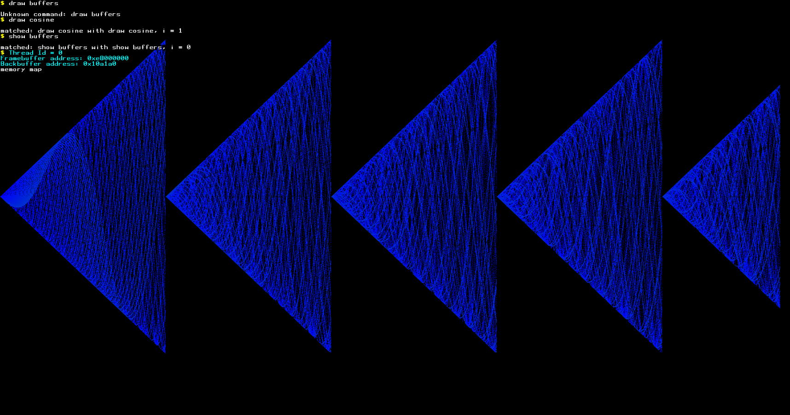
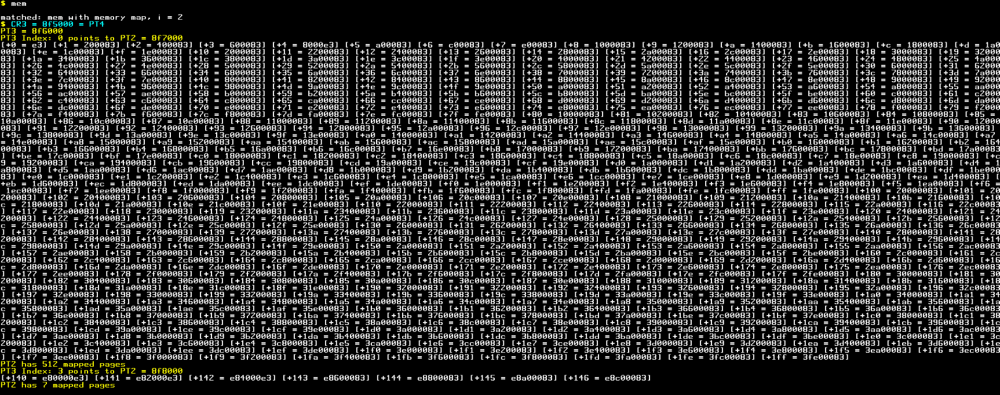

# AIOS64

A small 64-bit operating system for x86-64 PCs, written from scratch in C and NASM assembly.

AIOS64 boots through GRUB with Multiboot2. It switches the CPU from 32-bit protected mode into 64-bit long mode and draws a text terminal straight onto a 1920×1080 linear framebuffer. It also runs a tiny interactive shell on top of a preemptive, round-robin multitasking kernel. Every shell command runs as its own kernel task.



## Features

| Area | What is implemented |
|---|---|
| **Boot** | Multiboot2 header requesting a 1920×1080×32 framebuffer, a 32-bit entry stub, CPUID long-mode check, a 64-bit GDT and the jump to long mode |
| **Memory** | 4-level paging with 2 MiB huge pages: the first 1 GiB is identity mapped, plus a separate mapping for the framebuffer. A bump allocator serves the linker-reserved heap |
| **Interrupts** | 256-entry IDT, 8259 PIC remapped to vectors 32–47, PIT timer at 100 Hz, handlers for the keyboard, page faults (#PF) and general protection faults (#GP) |
| **Multitasking** | Preemptive round-robin scheduler driven by the timer IRQ. Tasks live in a circular doubly-linked run queue and get a 5-tick (~50 ms) time slice. The context switch is done in the timer ISR |
| **Synchronization** | Spinlocks built on `lock cmpxchg`, used together with `cli`/`sti` |
| **Input** | PS/2 keyboard driver with a scancode ring buffer, Shift and Caps Lock, and line input (`k_fgets`) |
| **Output** | Framebuffer text terminal (8×13 bitmap font, scrolling, `printf`-style formatting) and COM1 serial logging with log levels |
| **Shell** | Command shell with prefix matching. Each command is spawned as a new task |

## Quick start

You need [Docker](https://www.docker.com/) to build and [QEMU](https://www.qemu.org/) to run. From the repository root:

```bash
./docker-build
```

```bash
docker run --rm -v "$(pwd)":/root/env os64-build-env:latest make build-x86_64
```

```bash
./qemu-run
```

> **Note:** the `./build-x86` script runs `make all`, which currently does **not** build the kernel. Run the `make build-x86_64` command above instead. See [Getting Started](docs/getting-started.md#known-build-issue-make-all) for details.

The full walkthrough is in **[docs/getting-started.md](docs/getting-started.md)**, including Windows instructions, serial logging, debugging and adding your own commands.

## Shell commands

When the shell shows the `$ ` prompt, type a command and press Enter. A command matches if what you typed is a **prefix** of its name, so `mem`, `draw` and even `s` all work.

| Command | Short form | What it does |
|---|---|---|
| `show buffers` | `s` | Prints the current task ID and the physical addresses of the framebuffer and the back buffer |
| `draw cosine` | `d` | Plots 50 overlaid, modulated cosine curves directly to the framebuffer |
| `memory map` | `m` | Walks the page tables from `CR3` (PML4 → PDPT → PD) and dumps every mapped 2 MiB page |

Anything else prints `Unknown command: <text>`.



The commands are defined in [src/impl/kernel/shell/shell.c](src/impl/kernel/shell/shell.c).

## Documentation

- **[Getting Started](docs/getting-started.md):** building, running in QEMU, using the shell, serial logs, debugging and extending the shell.
- **[Architecture](docs/architecture.md):** how the OS is put together, with Mermaid diagrams of the boot sequence, memory layout, interrupts, scheduler, input pipeline and shell.
- **API reference:** run `./install_doxygen.sh` once, then `doxygen Doxyfile`. HTML is written to `doc/html/`.

## Source tree

```text
aios64/
├── Makefile                  build rules (cross gcc + nasm + ld + grub-mkrescue)
├── Dockerfile                build environment image (os64-build-env)
├── docker-build              builds the Docker image
├── build-x86                 runs `make all` in Docker (see the build note above)
├── docker-run.sh             interactive shell inside the build container
├── qemu-run                  boots dist/x86_64/kernel.iso in QEMU
├── Doxyfile                  Doxygen configuration
├── screenshots/              sample shell output
├── targets/x86_64/
│   ├── linker.ld             kernel memory layout (loaded at 1 MiB)
│   └── iso/boot/grub/grub.cfg
└── src/
    ├── intf/                 headers ("interfaces")
    │   ├── multiboot2.h, framebuffer.h, print.h, ascii_font.h
    │   └── kernel/{io,strings,util,sys/x86_64,x86_64}/
    └── impl/                 implementation
        ├── x86_64/           assembly and early-boot code
        │   ├── boot/         header.asm, main.asm (32-bit), main64.asm (64-bit), serial.asm
        │   ├── isr_stubs.asm interrupt entry points + context switch
        │   ├── scheduler/    task_switcher.asm
        │   ├── sync/         spinlock.asm
        │   └── readregs.asm  getCR3 / getRIP
        └── kernel/           C kernel
            ├── main.c        kernel_main, page-fault handler
            ├── sys/x86_64/   IDT, PIC/PIT, port I/O, ISRs (keyboard, #GP)
            ├── proc/         tasks, scheduler helpers, bump allocator
            ├── io/           keyboard, getchar, serial logging
            ├── gfx/          framebuffer, pixels, fonts, text terminal
            ├── shell/        the command shell
            ├── strings/      strlen / strncmp / strncpy
            └── util/         cosine, random24
```

## Status and limitations

AIOS64 is an experiment and a learning project. Some of its current limitations:

- Everything runs in ring 0. There is no user mode, no system calls and no per-process address spaces.
- Memory management is a bump allocator with no `free`. Finished tasks are never reclaimed.
- The terminal and pixel code assume a 1920-pixel-wide, 32-bpp framebuffer.
- The only devices are the legacy PIC, PIT, PS/2 keyboard and COM1. There is no APIC, ACPI, storage or filesystem.
- Several known issues in the scheduler and terminal are listed in [Architecture → Known issues](docs/architecture.md#known-issues).
