# AIOS64 Architecture

This document explains how AIOS64 is put together: how it boots, how memory is laid out, how interrupts reach the kernel, how tasks are scheduled, and how keyboard input becomes a shell command. Diagrams use [Mermaid](https://mermaid.js.org/), which GitHub renders natively.

Everything described here is the behaviour of the current code, rough edges included. Those are collected under [Known issues](#known-issues).

- [1. Overview](#1-overview)
- [2. Source layout](#2-source-layout)
- [3. Build pipeline](#3-build-pipeline)
- [4. Boot sequence](#4-boot-sequence)
- [5. Memory layout and paging](#5-memory-layout-and-paging)
- [6. Interrupts](#6-interrupts)
- [7. Tasks and scheduling](#7-tasks-and-scheduling)
- [8. Synchronization](#8-synchronization)
- [9. Keyboard input](#9-keyboard-input)
- [10. Graphics and the text terminal](#10-graphics-and-the-text-terminal)
- [11. Serial logging](#11-serial-logging)
- [12. The shell](#12-the-shell)
- [Known issues](#known-issues)

---

## 1. Overview

AIOS64 is a single-address-space, ring-0 kernel. There is no user mode: the shell and its commands are kernel tasks that share one set of page tables and call kernel functions directly.

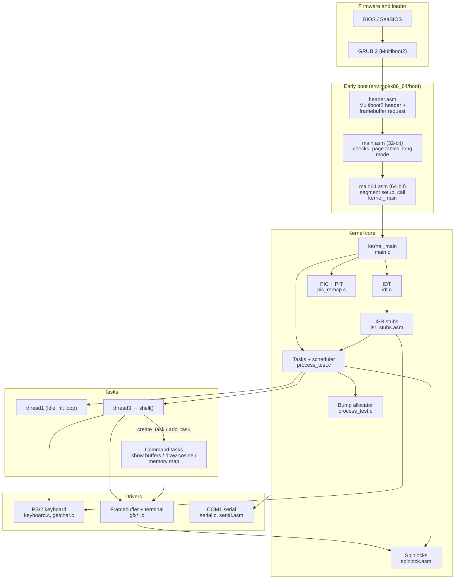

| Hardware | Used for | Code |
|---|---|---|
| Linear framebuffer (from GRUB) | All visible output | `gfx/` |
| 8259 PIC (master + slave) | IRQ routing, remapped to vectors 32–47 | `pic_remap.c` |
| 8253/8254 PIT channel 0 | 100 Hz scheduler tick | `pic_remap.c` (`pic_init_timer`) |
| PS/2 keyboard controller (`0x60`/`0x64`) | Input | `keyboard_handler.c`, `keyboard.c` |
| 16550 UART COM1 (`0x3F8`) | Debug log | `serial.asm`, `serial.c` |
| x87 FPU / SSE | Floating point in C code (e.g. `cosine`) | enabled in `main.asm` |

## 2. Source layout

The tree separates **interfaces** (`src/intf`, headers) from **implementation** (`src/impl`). Inside `impl`, `x86_64/` holds assembly and early-boot code and `kernel/` holds the C kernel.

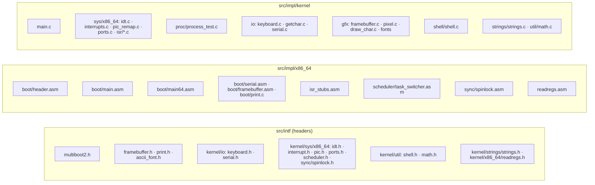

| File | Responsibility |
|---|---|
| [boot/header.asm](../src/impl/x86_64/boot/header.asm) | Multiboot2 header: magic `0xE85250D6` and a framebuffer tag requesting 1920×1080×32 |
| [boot/main.asm](../src/impl/x86_64/boot/main.asm) | 32-bit entry `start`: stack, serial, Multiboot check, framebuffer discovery, page tables, PAE/LME/PG, FPU/SSE, GDT, far jump |
| [boot/main64.asm](../src/impl/x86_64/boot/main64.asm) | 64-bit entry `long_mode_start`: zero the segment registers, call `kernel_main` |
| [boot/framebuffer.asm](../src/impl/x86_64/boot/framebuffer.asm) | Globals `framebuffer_addr/pitch/width/height/depth` filled by the boot code |
| [boot/serial.asm](../src/impl/x86_64/boot/serial.asm) | 32-bit COM1 init (9600 8N1) and print helpers used before long mode |
| [boot/print.c](../src/impl/x86_64/boot/print.c) | `printk` and the legacy VGA text-mode printer at `0xB8000` (not used in framebuffer mode) |
| [isr_stubs.asm](../src/impl/x86_64/isr_stubs.asm) | Interrupt entry points (`isr_timer`, `isr_keyboard`, `isr_page_fault`, `isr_gp_fault`), the **context switch**, `load_idt` |
| [scheduler/task_switcher.asm](../src/impl/x86_64/scheduler/task_switcher.asm) | Older `switch_task` / `switch_to_first_task` routines. Not used by the current timer-driven path |
| [sync/spinlock.asm](../src/impl/x86_64/sync/spinlock.asm) | `enter_critical_section` / `leave_critical_section` |
| [readregs.asm](../src/impl/x86_64/readregs.asm) | `getCR3`, `getRIP` |
| [main.c](../src/impl/kernel/main.c) | `kernel_main`, `page_fault_handler`, back buffer and blit helpers |
| [sys/x86_64/idt.c](../src/impl/kernel/sys/x86_64/idt.c) | IDT table, `set_idt_entry`, `idt_init`, `idt_load` |
| [sys/x86_64/pic_remap.c](../src/impl/kernel/sys/x86_64/pic_remap.c) | PIC remap/mask/unmask/EOI, PIT programming |
| [sys/x86_64/interrupts.c](../src/impl/kernel/sys/x86_64/interrupts.c) | `timer_handler` (tick and quantum accounting) |
| [sys/x86_64/isr/](../src/impl/kernel/sys/x86_64/isr/) | `keyboard_handler` (scancode ring) and `gp_fault_handler` |
| [proc/process_test.c](../src/impl/kernel/proc/process_test.c) | Task creation, run queue, `remove_task`, bump allocator, built-in threads |
| [io/keyboard.c](../src/impl/kernel/io/keyboard.c), [io/getchar.c](../src/impl/kernel/io/getchar.c) | Scancode → ASCII, `getchar`, `k_fgets` |
| [io/serial.c](../src/impl/kernel/io/serial.c) | `write_serial`, `printf_serial`, `log_serial` |
| [gfx/draw_char.c](../src/impl/kernel/gfx/draw_char.c) | Glyph rendering, `vsnprintf`, the scrolling terminal `printf_gfx_term` |
| [gfx/pixel.c](../src/impl/kernel/gfx/pixel.c), [gfx/framebuffer.c](../src/impl/kernel/gfx/framebuffer.c) | `putpixel`, `clear_screen`, `vsync` |
| [shell/shell.c](../src/impl/kernel/shell/shell.c) | The shell loop and its commands |

## 3. Build pipeline

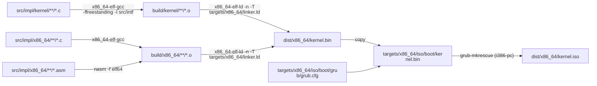

All tools run inside the `os64-build-env` Docker image. The working target is `make build-x86_64`; `make all` does not build anything (see [Getting Started](getting-started.md#known-build-issue-make-all)).

[grub.cfg](../targets/x86_64/iso/boot/grub/grub.cfg) boots immediately (`timeout=0`) with `multiboot2 /boot/kernel.bin` and `gfxpayload=1920x1080x32`.

## 4. Boot sequence

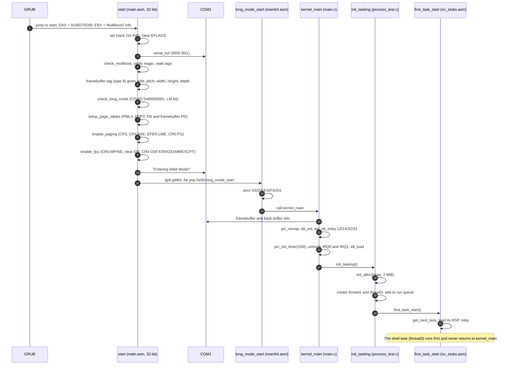

Notes:

- **Multiboot check:** `check_multiboot` compares EAX with `0x36D76289`. If they differ, it jumps to `error` with code `M`. It then walks the Multiboot2 tags (8-byte aligned) from `EBX + 8`, printing each tag type to serial, until it finds the framebuffer tag (type 8). It stores the address, pitch, width, height and depth into the globals in `framebuffer.asm`.
- **Error codes:** `error` writes `ERR: <code>` to VGA text memory at `0xB8000` and halts. The codes are `M` (not Multiboot2) and `L` (no long mode). A `check_cpuid` routine (`C`) exists but is not called.
- **GDT:** `gdt64` contains a null descriptor and one 64-bit code segment (selector `0x08`: executable, code/data, present, L-bit). There is no data descriptor; long mode ignores data segment bases and limits, so the data segment registers are simply loaded with 0.
- **Stack:** the boot stack is 16 KiB in `.bss` (`stack_bottom`…`stack_top`). After `init_tasking` every task runs on its own heap-allocated stack.
- `kernel_main` executes `sti` after `init_tasking`, but `init_tasking` never returns: interrupts are enabled when `iretq` loads the first task's RFLAGS (`0x286`, IF set).

## 5. Memory layout and paging

### Kernel image

[linker.ld](../targets/x86_64/linker.ld) places the kernel at **1 MiB** physical. Because the first GiB is identity mapped, virtual addresses equal physical addresses.

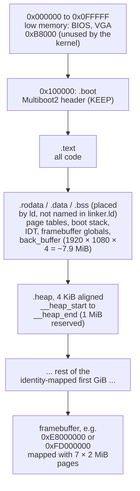

The `.rodata`, `.data` and `.bss` sections are orphan sections that `ld` places by itself. In the sample run the back buffer is at `0x10A1A0`, just after `.text`. `init_tasking` hands the allocator **2 MiB** starting at `__heap_start`, although the linker script reserves only 1 MiB (see [Known issues](#known-issues)).

### Page tables

The boot code builds 4-level paging using **2 MiB huge pages** (PS bit in the PD entries), with four 4 KiB tables in `.bss`:

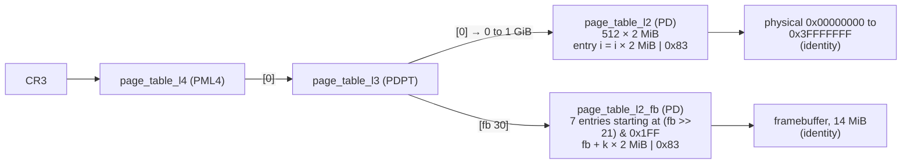

- Entry flags `0x83` = Present | Writable | Page Size (2 MiB). The CPU later sets Accessed/Dirty, which is why `memory map` shows some entries as `…e3`.
- The framebuffer gets its own page directory, so it can sit in any GiB below 4 GiB: the boot code reads only the low 32 bits of the address. With QEMU's `0xE8000000` that is PDPT index 3 and PD indices `0x140`–`0x146`, exactly what the `memory map` screenshot shows.
- There is one address space for everything. Nothing changes CR3 after boot.

### Heap

The allocator in `process_test.c` is a **bump allocator**:

```c
void *alloc(size_t size){
    size = (size+15) & ~0xF;           // 16-byte alignment
    if(heap_top + size > heap_end) return 0;
    void *ptr = heap_top; heap_top += size; return ptr;
}
```

It is used for `struct task` objects and 4 KiB task stacks. Nothing is ever freed. `reset_heap()` exists but is not called.

## 6. Interrupts

### Setup

`pic_remap()` re-initialises both 8259 PICs so that IRQ 0–7 map to vectors **32–39** and IRQ 8–15 to **40–47**, then masks every IRQ. `kernel_main` installs four gates (all `0x8E`: present, DPL 0, 64-bit interrupt gate, selector `0x08`), programs the PIT to 100 Hz (divisor 11931, mode 3), unmasks IRQ0 and IRQ1, and loads the IDT with `lidt`.

| Vector | Source | Entry stub | C handler |
|---|---|---|---|
| 13 | #GP general protection fault | `isr_gp_fault` | `gp_fault_handler` |
| 14 | #PF page fault | `isr_page_fault` | `page_fault_handler` |
| 32 | IRQ0, PIT timer | `isr_timer` | `timer_handler`, plus the context switch in assembly |
| 33 | IRQ1, keyboard | `isr_keyboard` | `keyboard_handler` |

All other vectors are zeroed (not present), so any other exception escalates to a double fault and then a triple fault.

### Flow

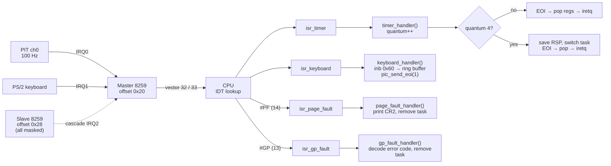

The stubs save all general-purpose registers and RFLAGS by hand (the code does not use `__attribute__((interrupt))`), call the C handler, restore everything and `iretq`. The timer stub sends EOI itself (`out 0x20, 0x20`), and the keyboard handler calls `pic_send_eoi(1)`.

### Fault handling

Both fault handlers log the fault (critical level) and then call `remove_task()` on the current task. Because the faulting task is the current task, `remove_task` jumps into the scheduler (`first_task_start`) and never returns. The rest of the system keeps running. The page-fault handler also prints `CR2` and the error code on screen.

## 7. Tasks and scheduling

### The task structure

From [scheduler.h](../src/intf/kernel/sys/x86_64/scheduler.h). The offsets matter because assembly code reads `rsp` at `+0x08` and `quantum` at `+0x48`.

| Offset | Field | Meaning |
|---|---|---|
| `0x00` | `next` | Next task in the circular run queue |
| `0x08` | `rsp` | Saved stack pointer. Points at the saved register frame |
| `0x10` | `rip` | Entry point (bookkeeping) |
| `0x18` | `rflags` | Unused by the current switch path |
| `0x20`–`0x40` | `rbx rbp r12 r13 r14` | Used only by the older `switch_task` routine |
| `0x48` | `quantum` | Ticks consumed in the current time slice |
| `0x50` | `prev` | Previous task in the run queue |
| | `pid` | Task ID |
| | `state` | `allocated`, `ready`, `running`, `waiting`, `done` |
| | `entry` | Entry function |

### Task lifecycle

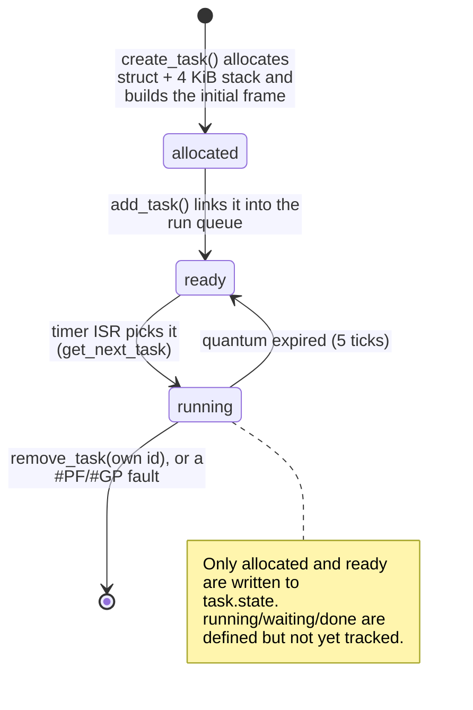

### Initial stack frame

`create_task(func, id)` allocates a 4 KiB stack and pre-builds the frame that the timer ISR's epilogue expects, so a new task starts the first time `iretq` "returns" into it:

```text
high addresses  ┌──────────────────────────┐ ← stack + 4096 - 8   (used as the SS slot)
                │ RSP for iretq            │
                │ RFLAGS = 0x286 (IF=1)    │
                │ CS     = 0x08            │
                │ RIP    = func            │ ← iretq frame
                │ 16 register slots        │   popped by the timer stub:
                │  (all 0 except the       │   popf, r15 … r8, rbp, rdi,
                │   slot holding the id)   │   rsi, rdx, rcx, rbx, rax
low addresses   └──────────────────────────┘ ← task->rsp
```

### Run queue

Tasks form a **circular doubly-linked list** and `current_task` points into it. `add_task` inserts the new task just before `current_task`, at the tail of the ring.

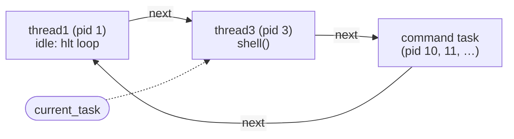

At boot, `init_tasking` creates `thread1` (pid 1) and `thread3` (pid 3, which calls `shell()`). It also creates `thread2` (pid 2), which is never added to the queue. It sets `current_task = thread1` and enters `first_task_start`, which advances to `thread1->next`, so **the shell is the first task to run**. Each shell command adds one more task to the ring until it removes itself.

### Context switch (timer tick)

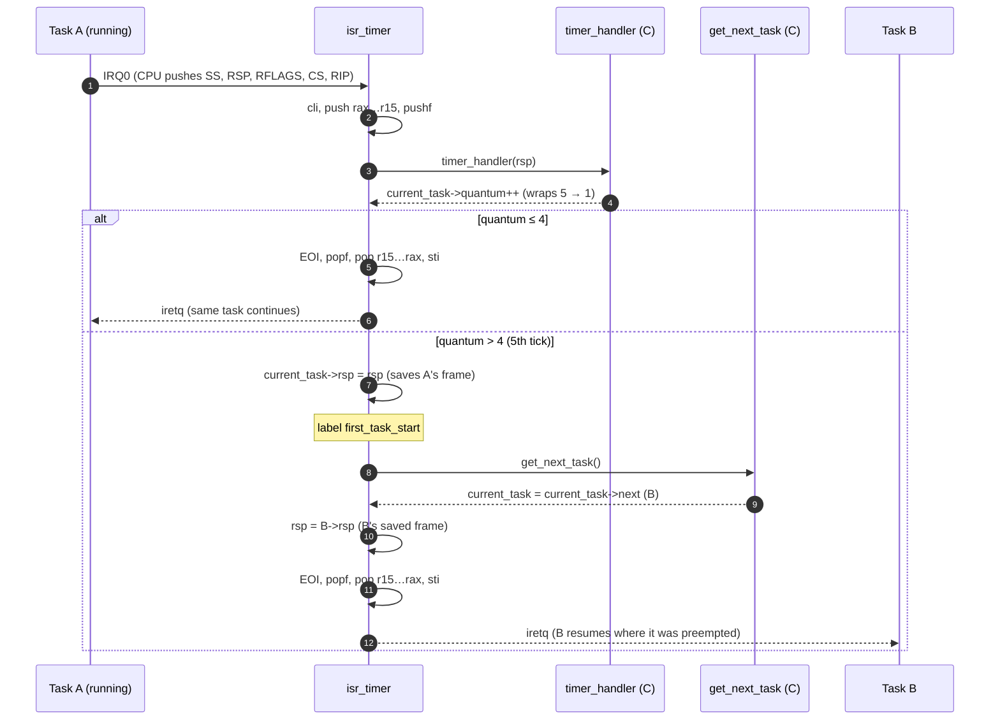

All of a task's state lives **on its own stack**: the CPU's interrupt frame plus the registers pushed by the stub. Switching tasks only means saving one RSP and loading another, and the shared epilogue restores the rest. At 100 Hz with a 5-tick slice, each task runs for about **50 ms** before being preempted.

`first_task_start` is a label in the middle of `isr_timer`. `init_tasking` jumps to it to start the first task, and `remove_task` jumps to it to leave a task that has removed itself.

[task_switcher.asm](../src/impl/x86_64/scheduler/task_switcher.asm) and `schedule()` in `process_test.c` are an earlier, cooperative `switch_task`-based design. They are still linked but are not called on the current path.

### Removing a task

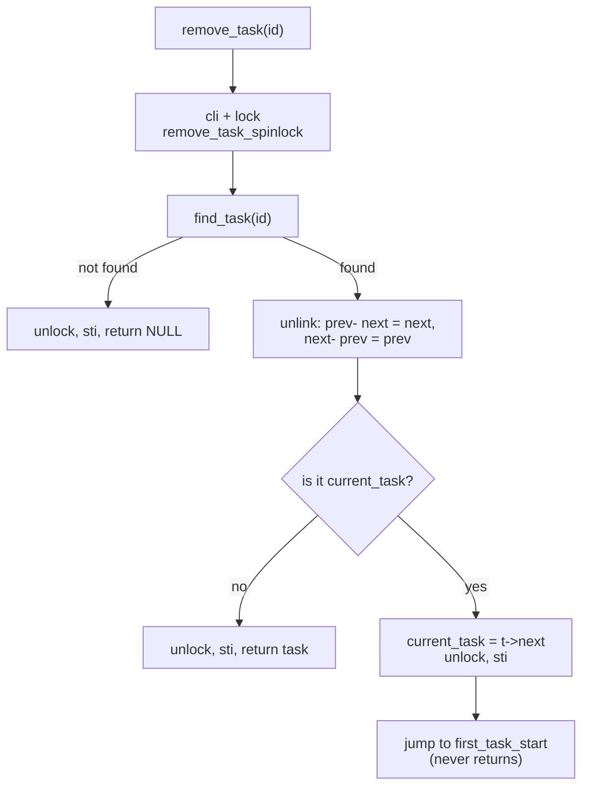

Shell commands end by calling `remove_task(get_current_task_id())`. Task functions must never return: there is no return address on a fresh task's stack.

## 8. Synchronization

AIOS64 runs on one CPU, but tasks are preempted at arbitrary points, so shared state is protected with spinlocks:

```nasm
enter_critical_section:        ; rdi = &lock
.try_lock:
    mov rax, [rdi]
    test rax, rax
    jnz .wait                  ; already held, spin
    mov rax, 0
    mov rcx, 1
    lock cmpxchg [rdi], rcx    ; atomically 0 → 1
    jz .got_lock
.wait:
    pause
    jmp .try_lock
```

`leave_critical_section` stores 0. A task that finds a lock held spins until its time slice ends and the holder gets to run and release it.

| Lock | Protects | Where |
|---|---|---|
| `printf_gfx_lock` | Terminal cursor and glyph drawing | `printf_gfx_term` in `draw_char.c` |
| `scroll_backbuffer_lock1` | Framebuffer scroll | `scroll_backbuffer` in `draw_char.c` |
| `remove_task_spinlock` | Run-queue unlinking (also wrapped in `cli`/`sti`) | `remove_task` in `process_test.c` |
| `showRegisterCR3_lock` | The `memory map` command's page-table walk | `shell.c` |

Interrupt handlers do not take locks. They run with interrupts disabled (`cli` in each stub), and the keyboard ring buffer is a single-producer / single-consumer queue with `volatile` indices.

## 9. Keyboard input

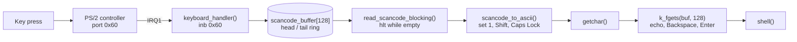

- **Producer:** `keyboard_handler` appends the raw set-1 scancode if the ring isn't full (otherwise the byte is dropped), then sends EOI.
- **Consumer:** `read_scancode_blocking` executes `hlt` until the ring is non-empty, so a waiting shell sleeps until the next interrupt (keyboard or timer).
- **Translation:** break codes (bit 7) update modifier state and return 0. Shift (`0x2A`/`0x36`) is tracked while held, and Caps Lock (`0x3A`) toggles and affects letter rows only. Unsupported keys map to 0.
- **Line editing:** `k_fgets` skips up to two 0 characters, echoes each character through `printf_gfx_term`, handles Backspace (`0x08`/`0x7F`) by moving the index back, and ends at `\n`/`\r`. The line is NUL-terminated and the newline is not stored.

`keyboard.c` also contains `getch()`, a polling driver that reads port `0x64`/`0x60` directly. It predates the interrupt-driven path and is unused.

## 10. Graphics and the text terminal

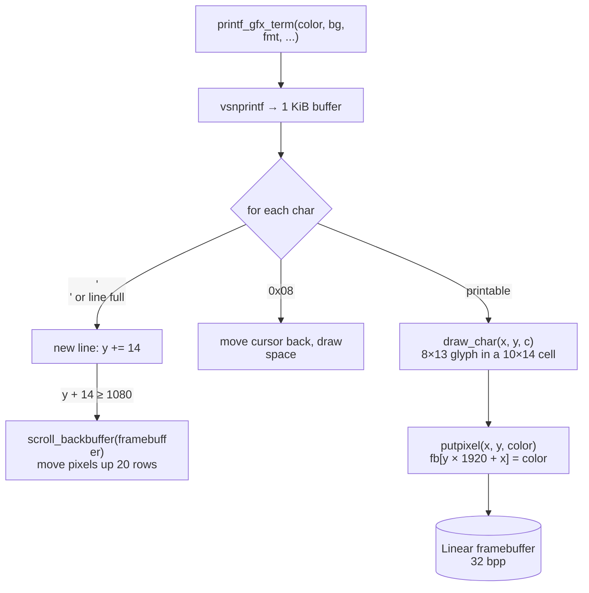

- **Pixels:** `putpixel` writes 32-bit values directly to the framebuffer. The stride is hard-coded to 1920 pixels and the `pitch` argument is ignored. Colours are `0x00RRGGBB`.
- **Fonts:** three bitmap fonts are compiled in (`ascii_7x11_font`, `ascii_8x13_font`, `ascii_16x26_font`). The terminal uses the 8×13 font in a 10×14 character cell, which gives 192 columns by 77 rows.
- **Cursor:** `printf_gfx_term` keeps a static cursor shared by all tasks, guarded by `printf_gfx_lock`, so output from concurrent tasks interleaves line by line rather than pixel by pixel.
- **Scrolling** copies the framebuffer up in place and clears the bottom rows.
- **Back buffer:** `back_buffer` (in `main.c`) and `blit_to_framebuffer` / `clear_back_buffer` support double buffering, but the terminal and `draw cosine` currently draw straight to the framebuffer. `vsync()` polls VGA port `0x3DA`, which is not meaningful for a linear framebuffer, and is not called.

## 11. Serial logging

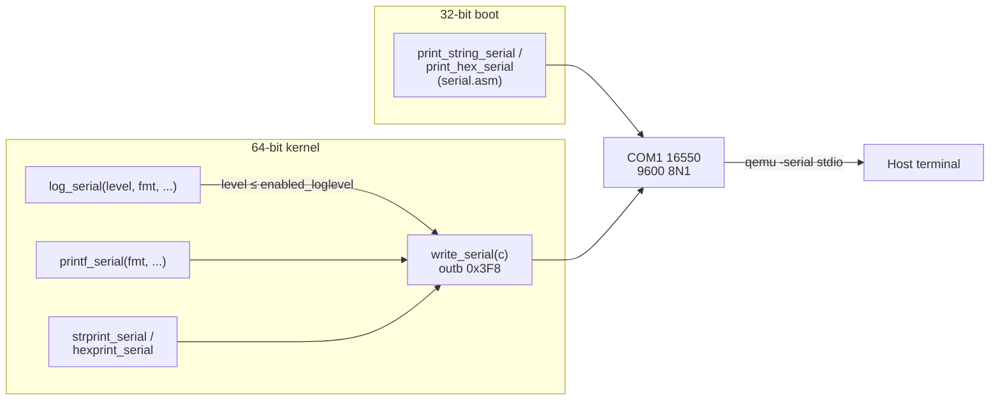

`serial_init` (32-bit) programs COM1 once during boot. `write_serial` writes to the data register without polling the line-status register, which is fine under QEMU. The level filter `enabled_loglevel` defaults to `critical`. See [Getting Started → Serial output](getting-started.md#6-serial-output-and-log-levels).

## 12. The shell

The shell is the `thread3` task. Its loop prints `$ `, reads a line with `k_fgets`, matches it against `commandsMap`, and hands it to `interpret()`. `interpret()` turns the command into a function pointer and **spawns a new task** for it, with task IDs counting up from 10.

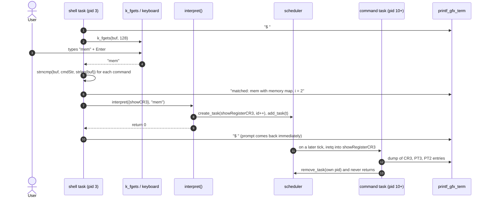

### Command table

```c
struct Command commandsMap[] = {
    { .cmd = showBuffers, .cmdStr = "show buffers" },
    { .cmd = drawCosine,  .cmdStr = "draw cosine"  },
    { .cmd = showCR3,     .cmdStr = "memory map"   },
    { .cmd = unknown,     .cmdStr = "UNKNOWN"      }   // sentinel, must be last
};
```

Matching compares the input against each name for `strlen(input)` characters, so any non-empty **prefix** of a name selects it, and the first match in table order wins. Input longer than the name, or input that differs anywhere, falls through to `Unknown command`.

| Command | Task function | Behaviour |
|---|---|---|
| `show buffers` | `showBuf` | Prints the current task ID, `framebuffer_addr` and `&back_buffer` |
| `draw cosine` | `drawCos` | For `f = 1..49`, plots `y = (x mod 400) · cos(x / f) + 500` for `x ∈ [0, 600π)` in steps of 0.1, colour `0xFF × f`. `cosine()` is a 10-term Taylor series |
| `memory map` | `showRegisterCR3` | Under `showRegisterCR3_lock`: reads CR3, follows PML4[0] to the PDPT, and for every non-empty PDPT entry prints each non-zero PD entry and a count |

See [Getting Started → Adding a shell command](getting-started.md#8-adding-a-shell-command) for how to add a command.

---

## Known issues

These are behaviours of the current code worth knowing about when reading or extending it.

| Area | Issue | Location |
|---|---|---|
| Build | `all: .PHONY` means `make all` (and `./build-x86`) builds nothing. Use `make build-x86_64`. `make clean` removes only assembly objects | [Makefile](../Makefile) |
| Scheduler | `get_next_task()` has no `return` on its success path. The timer stub uses RAX as the next task, so this relies on RAX happening to hold `current_task` | [process_test.c:67](../src/impl/kernel/proc/process_test.c:67) |
| Scheduler | `create_task`'s 16 register slots are one slot off from the order the timer stub pops them: the task ID ends up in RBP and RDI receives 0. Task functions therefore call `get_current_task_id()` instead of using their argument | [process_test.c:139](../src/impl/kernel/proc/process_test.c:139) |
| Scheduler | `add_task` sets `tail->prev = current_task`, which corrupts `prev` links once the ring has three or more tasks | [process_test.c:224](../src/impl/kernel/proc/process_test.c:224) |
| Scheduler | `find_task` returns early unless the ID is the current task, so `remove_task` can only remove the calling task | [process_test.c:261](../src/impl/kernel/proc/process_test.c:261) |
| Scheduler | When the current task removes itself, `current_task` is advanced and `first_task_start` advances it again, so one task is skipped for a slice | [process_test.c:296](../src/impl/kernel/proc/process_test.c:296) |
| Scheduler | FPU/SSE state is not saved on a context switch, so tasks using floating point (`draw cosine`) can corrupt each other's FP registers | [isr_stubs.asm](../src/impl/x86_64/isr_stubs.asm) |
| Memory | `init_alloc` is given 2 MiB, but `linker.ld` reserves only 1 MiB for `.heap` | [process_test.c:25](../src/impl/kernel/proc/process_test.c:25), [linker.ld](../targets/x86_64/linker.ld) |
| Memory | `memory map` masks entries with `0xFFFFFF00` and treats them as 32-bit pointers. Fine while tables are below 4 GiB | [shell.c](../src/impl/kernel/shell/shell.c) |
| Memory | Framebuffers above 4 GiB are not supported: the boot code reads only the low 32 bits of the address | [main.asm](../src/impl/x86_64/boot/main.asm) |
| Terminal | The Backspace branch of `printf_gfx_term` returns without `leave_critical_section`, leaving `printf_gfx_lock` held so later output can spin forever | [draw_char.c:348](../src/impl/kernel/gfx/draw_char.c:348) |
| Terminal | Lines advance 14 px, but `scroll_backbuffer` scrolls 20 px | [draw_char.c:164](../src/impl/kernel/gfx/draw_char.c:164) |
| Graphics | `putpixel` hard-codes a 1920-pixel stride and ignores `pitch` | [pixel.c](../src/impl/kernel/gfx/pixel.c) |
| Interrupts | `isr_page_fault` does not pop the CPU-pushed error code. This doesn't matter today because the handler never returns | [isr_stubs.asm](../src/impl/x86_64/isr_stubs.asm) |
